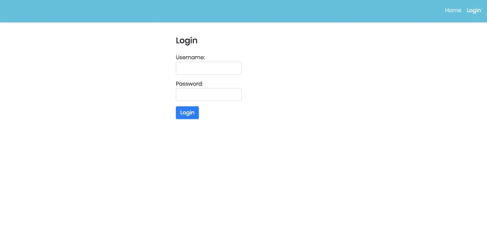
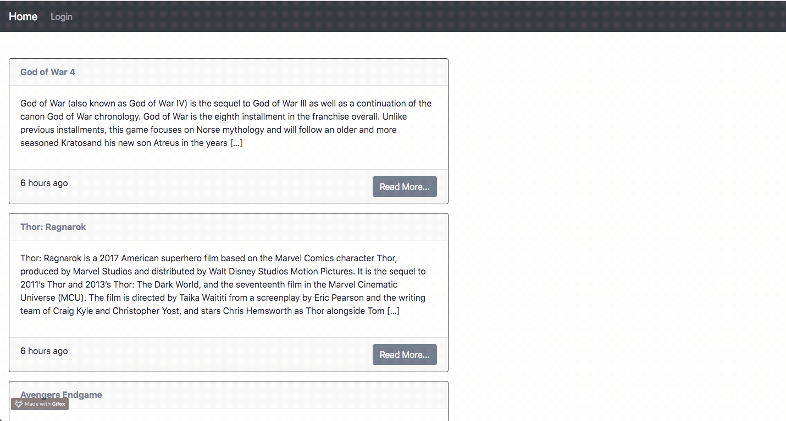

# React with WordPress

A modern React application for interacting with the WordPress REST API, built to demonstrate how to power a front-end dashboard, public content views, and authenticated content management workflows using WordPress as a CMS backend.

## Overview

This project brings together React, WordPress, and a dashboard-driven experience to let users:

- browse public posts and pages
- view a blog archive and individual article pages
- authenticate with WordPress through JWT-based flows
- manage posts and pages from a dedicated dashboard
- handle pagination and protected routes safely

The app is designed as a practical example for building headless CMS interfaces on top of WordPress, while keeping the WordPress backend as the system of record for content.

## Demo






## Features

- WordPress REST API integration for posts, pages, and content retrieval
- Secure authentication flow using JWT tokens
- Protected and public route handling
- Dashboard UI for managing content
- Create, read, and list workflows for posts/pages
- Pagination support for large post collections
- Custom endpoints support for WordPress integrations
- Responsive React interface for content-driven apps

## Tech Stack

- React 16
- React Router via Reach Router
- WordPress REST API
- Axios for HTTP requests
- JWT authentication
- Webpack + Babel for bundling
- CSS-based UI styling

## Project Structure

```bash
.
├── public/
│   └── index.html
├── src/
│   ├── App.js
│   ├── client-config.js
│   ├── index.js
│   ├── style.css
│   ├── components/
│   ├── context/
│   └── utils/
├── config.js
├── index.pug
├── package.json
├── server.js
├── webpack.config.js
├── demo-dashboard.gif
├── pagination.gif
├── render-posts.gif
└── README.md
```

## Prerequisites

Before running the app, make sure you have:

- Node.js and npm installed
- A working WordPress site with the REST API enabled
- Access to a WordPress admin account for content management
- Optional: JWT auth plugins or custom API endpoints depending on your auth setup

## Installation

1. Clone the repository:

```bash
git clone https://github.com/imranhsayed/react-with-wordpress.git
cd react-with-wordpress
```

2. Install dependencies:

```bash
npm install
```

## Configuration

Update your WordPress site URL in `src/client-config.js`:

```js
const clientConfig = {
  siteUrl: 'http://localhost:8888/wordpress'
};

export default clientConfig;
```

Replace the value with your local or production WordPress URL.

## Running the App

### Development

```bash
npm run dev
```

This starts the webpack dev server for local development.

### Production Build

```bash
npm run prod
```

This creates a production bundle for deployment.

## WordPress Integration Notes

This project is built to work with WordPress as a CMS backend. In practice, you may need to configure either:

- the WordPress JWT authentication plugin for protected routes
- custom REST API endpoints for additional functionality
- correct CORS and authorization headers for authenticated requests

If you're using JWT authentication, make sure your WordPress site is configured to allow token-based requests and that the browser sends the `Authorization: Bearer <token>` header on protected API calls.

## Authentication Flow

The application demonstrates a common headless WordPress pattern:

1. User logs in through a WordPress-backed auth endpoint.
2. JWT token is returned and stored locally.
3. Protected requests include the token in the authorization header.
4. WordPress validates the token and returns the requested content or action result.

This pattern is used for protected operations like creating posts and managing content in the dashboard.

## Main Routes

The app includes core navigation such as:

- `/` - home page
- `/blogs/` - blog listing
- `/post/:id` - single post details
- `/login` - login page
- `/dashboard` - dashboard overview
- `/dashboard/posts` - post management
- `/dashboard/create-post` - create new post
- `/dashboard/pages` - page management

## License

This project is distributed under the ISC license.

## Related Resources

- [WordPress REST API](https://developer.wordpress.org/rest-api/)
- [JWT Authentication for WP REST API](https://wordpress.org/plugins/jwt-authentication-for-wp-rest-api/)
- [REST API endpoints plugin example](https://github.com/imranhsayed/rest-api-endpoints)

## Notes

This repository is intended as a learning-focused implementation and practical example of how to build React interfaces powered by WordPress content and APIs.

